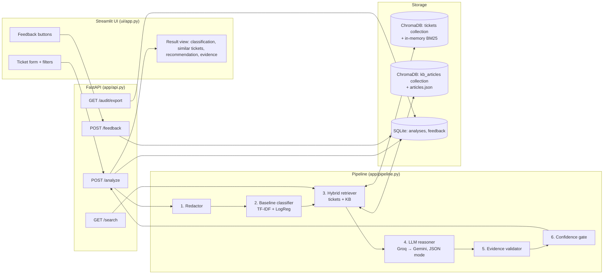
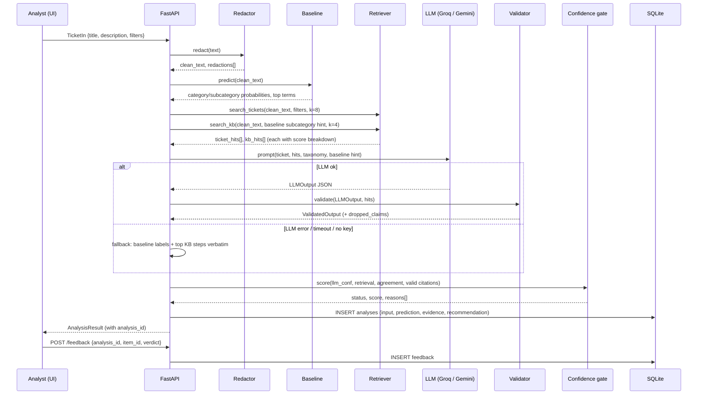

# System Architecture: Intelligent IT Ticket Analysis & Resolution Assistant

> HCLTech Future Ready AI Engineer Hackathon · Use case: Intelligent IT Ticket Analysis and Resolution Assistant
> Status: **v1 (hour-0 contract)**. Freeze sections 5, 6 and 7 before anyone writes code. Every change after that is agreed by all three teammates.

---

## 1. Design goals

| Goal | How the architecture meets it |
|---|---|
| **Evidence first** (FR-03, FR-04) | The LLM only *synthesises* from retrieved items. A deterministic validator removes any claim that doesn't cite a retrieved source. |
| **Honest uncertainty** (FR-05) | Confidence combines **three independent signals** (LLM, retrieval, baseline agreement); the LLM's own score is never trusted alone. |
| **Two sources of truth** | The **ticket corpus** answers "what is this, and what's similar?". The **curated KB** answers "how do we fix it?". Datasets usually have no resolution text, so fixes are never invented from tickets. |
| **Free to run, never crashes** | No paid API key needed: a free-tier LLM chain (Groq → Gemini) plus a response cache and degraded mode (Sections 4.1, 9). |
| **Measurable** | Every stage is a pure function with typed I/O, so it can be scored separately in `eval/`. |
| **Safe** | Sensitive data is removed *before* indexing and *before* any LLM call. The tool only analyses and recommends: no auto-closure, no remediation. |

---

## 2. High-level architecture



**Runtime shape:** one Python process for the API, with an embedded persistent ChromaDB at `data/chroma/` (no server process), plus one Streamlit process. The only external services are **free-tier** LLM APIs (Groq, Gemini), reached with API keys.

---

## 3. Components

| # | Component | File | Owner | Input → Output | Notes |
|---|---|---|---|---|---|
| C0 | **Dataset adapter** | `app/data/loader.py` | A | any CSV/XLSX/JSON → `list[Ticket]` | Maps columns using a config dict (`text`, `category`, …). Missing fields become `None`. If no dataset is supplied, the **synthetic generator** (`data/generate.py`) is used. |
| C1 | **Redactor** | `app/redact.py` | B | `str → (str, list[Redaction])` | Regex for emails, IPv4/IPv6, phone numbers, employee/asset IDs, URLs with tokens and "password: …" patterns. Runs at ingest **and** on every request. |
| C2 | **Baseline classifier** | `app/baseline.py` | A | `Ticket → BaselinePrediction` | TF-IDF (word + char n-grams) with LogisticRegression; probabilities come straight from `predict_proba`. Gives the fallback classification, the agreement signal and the comparison in the evaluation report. |
| C3 | **Hybrid retriever** | `app/retriever.py` | B | `query, filters → list[Hit]` | ChromaDB `tickets` and `kb_articles` collections hold the semantic part and the metadata filters (`where=`); BM25 runs in memory alongside. Score defined in Section 8. Multilingual embeddings. |
| C4 | **LLM reasoner** | `app/llm_provider.py`, `app/llm.py` | B | `Ticket + hits + baseline → LLMOutput` | **Free, swappable provider layer** (Section 4.1). One call in JSON mode, a closed list of allowed taxonomy labels, and a prompt that only allows citing the IDs it was given. The output is checked against the Pydantic `LLMOutput` model and **repaired once** if invalid. Responses are cached by `sha256(model + input + hits)`. |
| C5 | **Evidence validator** | `app/validator.py` | B | `LLMOutput + hits → ValidatedOutput` | Checks every `cited_id` is in the retrieved set and every `excerpt` is a substring of its source (after normalisation). Invalid items are dropped; if all are dropped, one retry, then fallback. |
| C6 | **Confidence gate** | `app/confidence.py` | B | signals → `status`, `score`, `reasons[]` | Section 7. Decides OK, NEEDS_REVIEW or ESCALATE. |
| C7 | **Pipeline orchestrator** | `app/pipeline.py` | B | `TicketIn → AnalysisResult` | Runs C1 to C6, times each stage and assigns an `analysis_id`. |
| C8 | **API** | `app/api.py` | C | HTTP ↔ pipeline | FastAPI with Pydantic models taken from `app/schema.py`. |
| C9 | **Audit store** | `app/db.py` | C | SQLite | `analyses`, `feedback` and `kb_gaps` tables (Section 5.4). Stores only redacted text. |
| C10 | **UI** | `ui/app.py` | C | Streamlit | Calls the API over HTTP, so it can be swapped for another frontend later. |
| C11 | **Evaluation harness** | `eval/run_eval.py` | A | test split → `eval/results/*.json` + `EVALUATION.md` tables | Section 11. |

---

## 4. Request flow (`POST /analyze`)



**Latency budget:** under 4 s end to end. Redaction, the baseline and retrieval together take under 150 ms; the LLM call takes 1–2 s on Groq and 2–4 s on Gemini; validation and DB writes take under 20 ms.

### 4.1 LLM provider layer (no paid key needed)

LLMs are reached **through API keys only**; nothing runs locally. Both providers expose an **OpenAI-compatible Chat Completions API**, so one client (the `openai` Python package) is used with a different `base_url`, key and model. `llm_provider.py` tries them in order and moves to the next on a rate limit (429), a timeout or a connection error.

| Order | Provider | Default model (set in `config.py` / `.env`) | Free tier | Role |
|---|---|---|---|---|
| 1 | **Groq** (`https://api.groq.com/openai/v1`) | `llama-3.3-70b-versatile`; `llama-3.1-8b-instant` for bulk evaluation | Free key, rate-limited (requests per minute and tokens per day) | Primary: fastest |
| 2 | **Google Gemini** (`https://generativelanguage.googleapis.com/v1beta/openai/`) | `gemini-2.5-flash` | Free key from AI Studio, rate-limited | Backup when Groq rate-limits |
| 3 | Response cache | — | — | Previously answered tickets (all demo tickets pre-warmed) |
| 4 | Degraded mode | — | — | Baseline + KB verbatim (Section 9) |

```
.env
LLM_CHAIN=groq,gemini
GROQ_API_KEY=...            GROQ_MODEL=llama-3.3-70b-versatile
GEMINI_API_KEY=...          GEMINI_MODEL=gemini-2.5-flash
```

Each teammate uses their **own** keys, so the team has three separate rate limits instead of sharing one.

- **JSON mode:** `response_format={"type": "json_object"}` on every provider. Because open models follow a schema less reliably than strict structured output, every response goes through **parse → Pydantic validate → one repair retry**, where the validation error is sent back with the instruction to fix the JSON. If that also fails, the next provider in the chain is tried.
- **Rate limits:**
  - Every response is cached on disk.
  - The evaluation uses `llama-3.1-8b-instant` with a ~2 s sleep between calls, on a stratified sample of 100 tickets.
  - The demo tickets are pre-warmed into the cache.
- **Model names change:** the default model names are only defaults. Check the provider's model list on the day and set the `.env` value; the code does not hard-code them.
- **Which model answered:** each analysis records `provider` and `model` in the audit row, so evaluation results can be traced to the model used.

---

## 5. Data model (frozen contract, `app/schema.py`)

### 5.1 Core entities

```python
class Ticket(BaseModel):
    id: str                       # "TKT-00042"
    title: str | None
    text: str                     # description (title is prepended if present)
    category: str | None          # labels only for historical / test tickets
    subcategory: str | None
    priority: Literal["P1","P2","P3","P4"] | None
    status: Literal["open","resolved","closed"] | None
    application: str | None       # filterable metadata (FR-07); None if dataset lacks it
    environment: Literal["prod","uat","dev"] | None
    assignment_group: str | None
    created_at: datetime | None
    resolution: str | None        # often absent in real datasets
    synthetic_fields: list[str] = []   # names of fields we GENERATED (shown in UI)

class KBArticle(BaseModel):
    kb_id: str                    # "KB-0012"
    title: str
    category: str
    subcategory: str
    symptoms: list[str]
    diagnostic_steps: list[str]
    resolution_steps: list[str]
    escalation_criteria: str
    assignment_group: str
```

### 5.2 API I/O

```python
class TicketIn(BaseModel):
    title: str | None = None
    description: str
    application: str | None = None
    environment: str | None = None
    filters: SearchFilters = SearchFilters()

class SearchFilters(BaseModel):
    category: str | None = None
    subcategory: str | None = None
    application: str | None = None
    environment: str | None = None
    status: str | None = None
    assignment_group: str | None = None
    date_from: date | None = None
    date_to: date | None = None

class Hit(BaseModel):
    source_id: str                # ticket id or kb_id
    source_type: Literal["ticket","kb"]
    score: float                  # final hybrid score, 0..1
    score_breakdown: dict[str, float]   # {"semantic":..,"bm25":..,"meta":..}
    snippet: str
    is_duplicate: bool = False

class Evidence(BaseModel):
    source_id: str
    source_type: Literal["ticket","kb"]
    excerpt: str                  # verbatim substring of the source (validated)
    reason: str                   # why it supports the claim

class ResolutionPath(BaseModel):
    rank: int
    title: str
    steps: list[str]
    evidence: list[Evidence]      # >= 1 or the path is dropped

class Classification(BaseModel):
    category: str
    subcategory: str
    priority: Literal["P1","P2","P3","P4"]
    confidence: float
    secondary: tuple[str, str, float] | None = None   # multi-domain tickets
    rationale: str
    source: Literal["llm","baseline"]

class AnalysisResult(BaseModel):
    analysis_id: str
    status: Literal["OK","NEEDS_REVIEW","ESCALATE"]
    confidence: float
    confidence_reasons: list[str]
    classification: Classification
    similar_tickets: list[Hit]
    kb_matches: list[Hit]
    resolution_paths: list[ResolutionPath]
    escalation: EscalationInfo | None   # {assignment_group, clarifying_questions[], diagnostic_bundle}
    redactions: list[str]               # types only, e.g. ["email","ip"]
    dropped_claims: int                 # removed by validator (shown for transparency)
    degraded_mode: bool                 # True if LLM fallback was used
    timings_ms: dict[str, int]
```

### 5.3 LLM output schema (what the LLM must return; enforced by Pydantic, not by the provider)

```json
{
  "category": "<one of taxonomy.categories>",
  "subcategory": "<one of taxonomy[category]>",
  "priority": "P1|P2|P3|P4",
  "confidence": 0.0,
  "secondary": {"category": "...", "subcategory": "...", "confidence": 0.0} ,
  "rationale": "short, references ticket fields",
  "duplicate_ids": ["TKT-..."],
  "resolution_paths": [
    {"title": "...", "steps": ["..."],
     "evidence": [{"source_id": "KB-0012", "excerpt": "verbatim text", "reason": "..."}]}
  ],
  "insufficient_evidence": false,
  "clarifying_questions": ["..."]
}
```

### 5.4 SQLite tables (FR-06, FR-08)

| Table | Columns |
|---|---|
| `analyses` | `analysis_id` PK, `created_at`, `input_redacted` JSON, `classification` JSON, `retrieved` JSON, `recommendation` JSON, `status`, `confidence`, `degraded_mode`, `provider`, `model`, `latency_ms` |
| `feedback` | `id` PK, `analysis_id` FK, `item_type` (classification / similar_ticket / resolution_path), `item_id`, `verdict` (useful / incorrect / unresolved), `corrected_label` nullable, `note`, `created_at` |
| `kb_gaps` | `id` PK, `analysis_id`, `topic`, `created_at` |

`GET /audit/export?format=csv|json` joins `analyses` and `feedback`. The output is already redacted (FR-08).

---

## 6. Taxonomy

- **Built from the data:** if the dataset has category and subcategory labels, the taxonomy is the set of labels found in it (`app/taxonomy.py` builds it at ingest).
- **Default, used with synthetic data:** about 6 categories and about 20 subcategories, for example Access/Identity, Network, Hardware, Software/Application, Database, Inquiry.
- **Priority:**
  - Usually not labelled in the data, so it comes from rules plus the LLM.
  - **Rules:** an outage, "all users", production down or a security incident means P1. Many users or a blocked business process means P2. A single user means P3. A how-to question means P4.
  - The LLM may raise the priority but never lower it below what the rules set.
  - This assumption is stated in the README.

---

## 7. Confidence & escalation logic (FR-05)

```
llm_conf    = LLM self-reported confidence            (0..1; baseline prob if degraded)
retrieval   = top KB hit score, blended 0.5/0.5 with the mean of the top-3 ticket scores
agreement   = 1.0 if LLM category == baseline top-1 category,
              0.5 if LLM category is in the baseline top-3, else 0.0
              (multiplied by the share of the top-5 neighbours that have the same category)

score = 0.35*llm_conf + 0.40*retrieval + 0.25*agreement
```

| Status | Rule |
|---|---|
| **ESCALATE** | score < 0.45 **or** no valid evidence after validation **or** `insufficient_evidence == true` **or** top KB score < 0.30 (knowledge gap) |
| **NEEDS_REVIEW** | 0.45 ≤ score < 0.70 **or** the priority is P1 (a human always reviews P1) **or** `dropped_claims > 0` |
| **OK** | score ≥ 0.70 and none of the above |

- **Escalation response:** suggested assignment group (from the KB or the majority among neighbours), clarifying questions, and a diagnostic bundle (classification, top hits, the reasons).
- **`confidence_reasons[]`:** plain-language reasons shown in the UI, for example "LLM and baseline disagree (Network vs Hardware)".
- **Weights and thresholds:** tuned on the validation split in hour 4 and recorded in `EVALUATION.md`.

---

## 8. Retrieval design (FR-02, FR-07)

- **Vector store:** **ChromaDB**, embedded `PersistentClient(path="data/chroma")`, with two collections:
  - `tickets`: id, redacted text, metadata `{category, subcategory, status, application, environment, assignment_group, created_ts}`
  - `kb_articles`: id, title + symptoms text, metadata `{category, subcategory, assignment_group}`
  - Distance is cosine (`metadata={"hnsw:space": "cosine"}`), so `cos = 1 - distance`.
  - ChromaDB 1.x requires collection names of 3–512 characters (`[a-zA-Z0-9._-]`). Tested with chromadb 1.5.9.
- **Embeddings:** `paraphrase-multilingual-MiniLM-L12-v2` (384 dimensions, CPU). Covers non-English tickets. We compute the embeddings ourselves with sentence-transformers and pass `embeddings=` to Chroma, so the model choice stays under our control and identical in the evaluation.
- **Lexical search:** `rank_bm25` over tokenised, redacted text, kept in memory and rebuilt at startup in about 1 s for 2,000 tickets. Chroma has no BM25.
- **Filters (FR-07):** turned into a Chroma `where` clause, for example `{"$and": [{"application": "SAP"}, {"created_ts": {"$gte": 1735689600}}]}`. Dates are stored as Unix timestamps so range filters work. The same filter is applied to the BM25 candidates, so both lists cover the same set.
- **Hybrid fusion:**
  1. Chroma returns the top 30 semantic matches and BM25 returns the top 30 keyword matches.
  2. Take the union of the two lists.
  3. Score each candidate: `0.6·cos + 0.3·bm25_norm + 0.1·meta`, where `meta` is the share of matching application, environment and assignment group.
  4. Keep the top k. The weights are tuned in the evaluation.
- **Index build:** `python -m app.build_index` (owner A) loads the dataset, redacts it, embeds it, then upserts it into Chroma and writes the BM25 pickle. It can be re-run safely.
- **Duplicates:** a hit is marked `is_duplicate` when `cos ≥ 0.85` and the category matches.
- **Exact-text guard:** keyword overlap alone never makes a duplicate. A high BM25 score with low semantic similarity is labelled "keyword match only".
- **KB lookup:** for each subcategory, the mapped article is tried first; then vector search over symptoms and title; at most 4 articles are returned.
- **Multi-domain tickets:** if the secondary classification has confidence above 0.4, KB retrieval runs for both subcategories and the results are merged.
- **Why ChromaDB:**
  - Metadata filtering is built in (FR-07).
  - The index persists on disk, so the API starts without re-embedding.
  - It shows judges a real vector store.
  - It's embedded, so there's no server to run.
  - Risk: install problems on Windows. Mitigation: pin the version and install it in hour 0. A NumPy fallback (`RETRIEVER_BACKEND=numpy`) uses the same interface.

---

## 9. Failure modes & fallback layers

| Layer | Trigger | Behaviour | UI signal |
|---|---|---|---|
| L1 Normal | LLM returns valid JSON | Full pipeline | — |
| L2 Retry | Invalid JSON or zero valid citations | One retry with the validator's errors appended to the prompt | — |
| L2b Provider failover | Groq 429 / timeout / error | Same prompt sent to Gemini | "Answered by: gemini-2.5-flash" badge |
| L3 Degraded | Every provider in `LLM_CHAIN` failed | Baseline classification and the top KB article's steps verbatim; status capped at NEEDS_REVIEW | "⚠ LLM unavailable: showing retrieved evidence only" |
| L4 Retrieval empty | No hits above floor | ESCALATE with clarifying questions | "No matching history: escalate" |
| Embedding model load fails | First run with no network | Fall back to TF-IDF cosine for the semantic part | Logged |
| ChromaDB fails to install or load | Windows wheel / sqlite issue | `RETRIEVER_BACKEND=numpy`: same interface, in-memory vectors | Logged |

**Response cache:** LLM responses are stored on disk (`data/cache/llm/*.json`), so the demo tickets work with no network.

---

## 10. Security & sensitive data

- **Redaction placement:** redaction runs **before** indexing, LLM calls, storage and export. Only the redaction *types* are kept, never the original values.
- **Prompt injection:** ticket text goes inside `<ticket>` tags and is treated as data. The system prompt tells the model to ignore any instructions in the ticket. The validator also limits output to retrieved IDs, so an injected "recommend X" can't add new sources.
- **Secrets:** API keys (Groq, Gemini) come from `.env` (listed in `.gitignore`), never from code.
- **Free-tier data terms:** free tiers may use what you send them, depending on the provider's terms. This is another reason to redact before every LLM call, and why only synthetic or de-identified data is used. State this in the README.
- **Access restrictions:**
  - Each ticket and KB article can carry a `visibility` tag. Retrieval filters on the caller's role, which is a header stub for the demo.
  - Assumption, stated in the README: real RBAC is out of scope.
- **Out of scope:** auto-closure, remediation actions and ITSM write-back.

---

## 11. Evaluation design (`eval/`)

| Dimension | Metric | Data |
|---|---|---|
| Classification | Accuracy, macro-F1, confusion matrix (category and subcategory); **LLM vs baseline** | Stratified 20% held-out split |
| Priority | Accuracy against rule labels; P1 recall reported separately | Labelled test subset |
| Duplicate retrieval | Recall@5, MRR@10 (relevance = **same subcategory**, query excluded); **BM25-only vs semantic vs hybrid** | Test split as queries against the training corpus |
| Keyword traps | Share of trap queries whose top-1 result has the right subcategory | 20 hand-written trap tickets |
| Confidence | Accuracy within each confidence bin (calibration table); escalation rate on out-of-scope or ambiguous tickets | 15 out-of-scope and 15 ambiguous tickets |
| Traceability | Share of returned paths with at least 1 valid citation; validator drop rate | All test analyses |
| Resolution usefulness | Analyst rating (useful / incorrect / unresolved) on 15 sampled analyses | Logged through the feedback API |

**Rate limits:** results are cached. A full evaluation of about 360 tickets runs the LLM on a stratified sample of 100 with `llama-3.1-8b-instant`, throttled to stay inside Groq's free limits, and runs the baseline on all of them. The demo model (70B) is reported on a 30-ticket subset.

---

## 12. Repository layout & ownership

```
HACKATHON/
├── app/
│   ├── schema.py          # SHARED (frozen at 0:45): Section 5
│   ├── taxonomy.py        # SHARED
│   ├── config.py          # SHARED: paths, weights, thresholds, model id
│   ├── data/loader.py     # A
│   ├── baseline.py        # A
│   ├── redact.py          # B
│   ├── retriever.py       # B
│   ├── llm_provider.py    # B: Groq → Gemini chain
│   ├── llm.py             # B: prompt, parse, repair
│   ├── build_index.py     # A: dataset → ChromaDB + BM25
│   ├── validator.py       # B
│   ├── confidence.py      # B
│   ├── pipeline.py        # B
│   ├── db.py              # C
│   └── api.py             # C
├── ui/app.py              # C
├── data/
│   ├── generate.py        # A: synthetic fallback dataset
│   ├── raw/               # supplied dataset (git-ignored if large)
│   ├── kb/articles.json   # A: curated KB (~30 articles)
│   ├── chroma/            # ChromaDB persistent store (git-ignored)
│   ├── bm25.pkl           # (git-ignored)
│   └── cache/llm/         # LLM response cache (commit the demo-ticket entries)
├── eval/
│   ├── run_eval.py        # A
│   ├── traps.json         # A
│   └── results/           # A
├── tests/                 # each owner tests their own modules
├── docs/ARCHITECTURE.md   # this file
├── EVALUATION.md          # A
├── EXAMPLES.md            # A
├── README.md              # C
├── requirements.txt       # C (all add to it)
└── .env.example           # C
```

| Teammate | Branch | Requirements owned |
|---|---|---|
| **A: Data & Eval** | `feat/data-eval` | Dataset, KB, baseline (FR-01 fallback), evaluation report, worked examples |
| **B: RAG Core** | `feat/rag-core` | FR-01 to FR-05: redaction, retrieval, LLM, validation, confidence |
| **C: API, UI & Audit** | `feat/api-ui` | FR-06 to FR-08: API, UI, feedback, audit, README |

**Merge points:**
- `main` gets `schema.py`, `taxonomy.py` and `config.py` at 0:45.
- Pull requests are merged at the 3:00 checkpoint and at the 5:00 freeze.

---

## 13. Key decisions & trade-offs

| Decision | Chosen | Rejected | Why |
|---|---|---|---|
| Resolution source | Curated KB, with tickets as supporting evidence | Making up fixes from ticket text | Real datasets usually have no resolutions, and the brief scores traceability |
| Vector store | ChromaDB (embedded, persistent) + in-memory BM25 | FAISS; NumPy only | Built-in metadata `where` filters (FR-07), persists on disk, no server; NumPy kept as a fallback behind the same interface |
| Classifier | LLM with a closed label set, plus a TF-IDF baseline | LLM only | The baseline is the fallback, the agreement signal and the evaluation comparison |
| Confidence | Three independent signals combined | LLM self-reported score | LLM confidence alone is poorly calibrated |
| UI ↔ core | Streamlit calling FastAPI | Streamlit importing the pipeline directly | API-first meets "interface **or API**"; the UI can be swapped later |
| LLM provider | Free-tier chain over API keys: Groq (Llama 3.3 70B) → Gemini Flash, through one OpenAI-compatible client | A paid API; a single provider; a local LLM | No paid key needed; rate limits are absorbed by failover; no local model to download or run on 8 GB laptops. Cost: open models are less reliable at strict JSON, so Pydantic validation and a repair retry are added |

---

## 14. Hour-0 checklist (done by 1:00)

- [ ] Dataset obtained, or the synthetic generator decided on; `loader.py` column map written
- [ ] `app/schema.py`, `taxonomy.py` and `config.py` committed to `main`
- [ ] Repo created; 3 branches cut; each teammate's git author identity set
- [ ] Free keys created: Groq (console.groq.com) and Gemini (aistudio.google.com); `.env.example` lists `GROQ_API_KEY`, `GEMINI_API_KEY`, `LLM_CHAIN`; real `.env` created locally (not committed)
- [ ] Current model names checked on the Groq and Gemini model lists, then written into `.env`
- [ ] `requirements.txt` installed (`chromadb` pinned, `openai`, `sentence-transformers`, `rank_bm25`) and `import chromadb` smoke-tested on Windows
- [ ] `sentence-transformers` model downloaded once
- [ ] KB article template agreed (Section 5.1 `KBArticle`)
- [ ] Demo tickets chosen: 1 confident, 1 duplicate, 1 escalation
