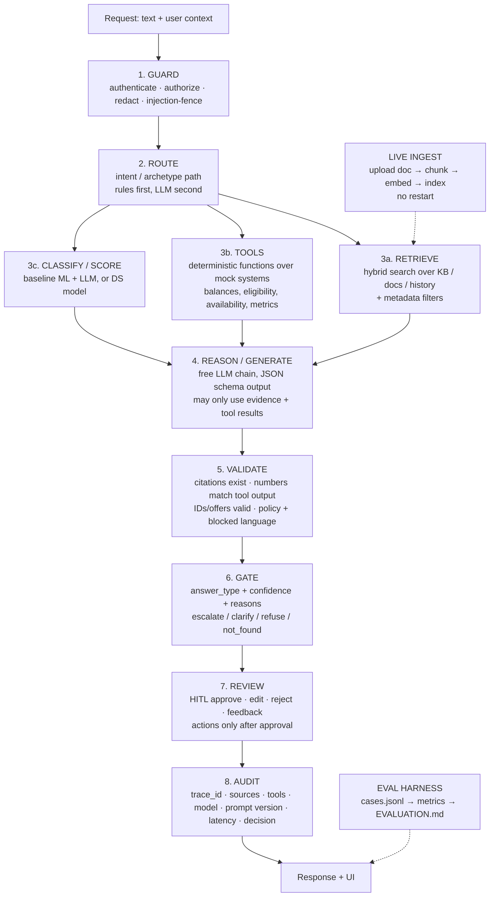

# Hackathon Playbook: One Pipeline for Any HCLTech "Future Ready" Problem Statement

> Use this in the **first 15 minutes** after the problem statement is revealed. It turns any brief into an architecture, a team split and a 6-hour schedule.
> Built from 11 real briefs: AI Engineer UC1, UC2, UC4, UC5, Banking, Hospital, Library; Data Science UC2, UC3, UC4, UC5.

---

## 0. What every brief has in common

Every AI Engineer brief asks for the same eight things in different words.

| What judges look for | Their wording varies | Our standard module |
|---|---|---|
| Answers backed by evidence | "grounded", "citations", "traceability", "evidence-backed" | `retrieve` + `validate` |
| Honest when unsure | "confidence & fallback", "not_found", "no hallucinations", "abstention" | `gate` (answer types) |
| Facts come from deterministic code, not the LLM | "deterministic tools", "eligibility must remain deterministic" | `tools` |
| Human in the loop | "analyst feedback", "human review", "approval", "escalation" | `review` |
| Audit trail | "audit-friendly", "trace ID", "observability" | `audit` |
| Privacy | "redaction", "mask", "authorization", "another patient's data" | `guard` |
| Safe with untrusted input | "untrusted content", "prompt injection" | `guard` |
| A measured evaluation | "evaluation report", "labelled test set", "p50/p95" | `eval` |

**Strategy:**
- **Bring one chassis to every brief.** About 70% of the code (ingest, retrieve, LLM, validate, gate, audit, UI shell, eval harness) is the same for every brief.
- **Only the domain layer changes per brief.** That's the taxonomy, the tools, the knowledge base and the prompts, about 30% of the work.
- **Spend the saved time on evaluation and safety demos.** That's where scores separate teams.

---

## 1. Step 1: classify the brief (minute 0–10)

Read the brief, then pick **one primary archetype**. Most briefs also use features from a second one.

| Archetype | You know it when the brief says… | Briefs |
|---|---|---|
| **A. Analyze → Recommend** (triage) | "classify", "similar historical cases", "ranked diagnosis", "recommend resolution" | UC1 IT Ticket, UC4 API Failure |
| **B. Grounded Q&A** (RAG) | "ingest PDF/HTML/MD", "answer only from documents", "citations", "conflicting passages" | UC2 Enterprise Docs Q&A, policy questions in Hospital and Library |
| **C. Tool-using assistant** (agentic) | "conversational", "execute actions", "tools: get_balance…", "authenticate", "answer_type", "trace ID" | Banking, Hospital, Library |
| **D. Generate with guardrails** | "draft message/email", "approved templates", "eligibility checks", "block sending", "mock delivery" | UC5 Customer Engagement |
| **E. Classic DS / ML** | "notebook", "chronological holdout", "PR-AUC / MAE / F1", "dashboard", "threshold" | DS UC2 Next Bill, UC3 Churn, UC4 Ticket Classification, UC5 Anomaly |

**Then fill in this one-page card** and paste it at the top of the README:

```
Problem:            <one sentence>
Primary archetype:  A | B | C | D | E      Secondary: ...
Users:              <analyst / customer / patient / librarian>
Inputs:             <ticket text / docs / logs / profile / question>
Outputs:            <classification / answer+citations / action / draft / score>
Deterministic parts (LLM must NOT do these): <eligibility, amounts, dates, availability, actions>
Knowledge sources:  <KB, policies, API docs, catalog>
Structured systems (become mock tools):      <core banking, EMR, circulation…>
Risky actions needing approval:              <block card, reschedule, send email…>
Required demo scenarios (copy from brief):   1. … 2. … 3. …
Metrics named in brief:                       <exact list>
```

> **Tip:** the "Expected Submission" and "Minimum Demonstration Scenario" sections are your **acceptance tests**. Turn each line into a test case in `eval/cases.jsonl` within the first hour.

---

## 2. The universal pipeline (the chassis)



### 2.1 Module contracts (same names in every project)

| # | Module | File | Responsibility | Domain-specific part |
|---|---|---|---|---|
| 1 | **guard** | `core/guard.py` | Trusted identity from request context (never from the prompt), role check, regex redaction, wrapping untrusted text in `<data>` tags | Redaction patterns (PAN/Aadhaar/card numbers, MRN, tokens, API keys) |
| 2 | **router** | `core/router.py` | Intent → handler. Keyword/regex rules first (fast, testable), LLM classifier as fallback | Intent list |
| 3a | **retrieve** | `core/retrieve.py` | ChromaDB + BM25 hybrid, metadata filters, chunking with `doc / section / page / version / effective_date` metadata | Which collections exist |
| 3b | **tools** | `core/tools.py` + `domain/tools_*.py` | Registry of pure Python functions with JSON schemas, running over SQLite mock systems | The tools themselves |
| 3c | **classify** | `core/classify.py` | TF-IDF + LogReg baseline, plus the LLM with a closed label set, plus agreement | Taxonomy |
| 4 | **llm** | `core/llm.py` | Groq → Gemini chain (API keys), JSON mode, Pydantic validation, one repair retry, disk cache | Prompts in `domain/prompts/*.md` (versioned) |
| 5 | **validate** | `core/validate.py` | (a) each cited ID was retrieved; (b) each excerpt is a substring of its source; (c) each number/date/amount in the text appears in a tool output; (d) offer/product IDs exist and are eligible; (e) blocked-phrase list | Policy rules |
| 6 | **gate** | `core/gate.py` | Combine signals → `answer_type`, `confidence`, `reasons[]` | Thresholds |
| 7 | **review** | `core/review.py` | Pending-approval queue for actions and drafts; feedback capture | Which actions need approval |
| 8 | **audit** | `core/audit.py` | SQLite `traces` table, plus `feedback` and `actions`; CSV/JSON export with personal data redacted | — |
| — | **ingest** | `core/ingest.py` | PDF (pypdf), HTML (bs4), MD, TXT, CSV/XLSX → chunks → index; called by an upload endpoint (live, no restart) | Source metadata |
| — | **api** | `app/api.py` | FastAPI: `/ask` or `/analyze`, `/ingest`, `/feedback`, `/review/{id}`, `/audit/export`, `/health` | Endpoint names |
| — | **ui** | `ui/app.py` | Streamlit tabs: **Assistant** (chat or form) · **Review queue** · **Evidence/Trace viewer** · **Dashboard** · **Admin upload** | Labels |
| — | **eval** | `eval/run.py` | Runs `cases.jsonl` through the API and writes metrics + a markdown table | Metric set |

### 2.2 The universal response envelope

Every brief's output fits this one shape. The Hospital brief's `answer_type` list covers all the others.

```json
{
  "trace_id": "TRC-20261110-0042",
  "answer_type": "retrieved_fact | calculated | action_completed | action_pending_approval | recommendation | clarification_needed | not_found | refused | conflict_flagged | escalated",
  "answer": "human-readable text",
  "confidence": 0.82,
  "confidence_reasons": ["top evidence score 0.78", "LLM and baseline agree"],
  "classification": {"label": "...", "sublabel": "...", "priority": "P2", "confidence": 0.8},
  "citations": [{"source_id": "KB-0012", "source_type": "kb|doc|ticket|system", "section": "3.2", "version": "v4", "effective_date": "2026-01-01", "excerpt": "verbatim", "reason": "why it supports"}],
  "tools_invoked": [{"tool": "get_balance", "args": {"customer_id": "C1001"}, "status": "ok", "latency_ms": 12}],
  "items": [],
  "clarifying_questions": [],
  "escalation": {"to": "L2 Network", "why": "..."},
  "conflicts": [{"a": "DOC-3 v2", "b": "DOC-7 v3", "resolution": "v3 effective 2026-03-01 applied"}],
  "privacy": {"redactions": ["email"], "authz_checked": true},
  "model": {"provider": "groq", "name": "llama-3.3-70b-versatile", "prompt_version": "answer_v3"},
  "timings_ms": {"total": 1840}
}
```

`items` holds the domain payload: similar tickets, ranked diagnoses, recommended books, a message draft, and so on.

### 2.3 Golden rules (say these in the demo; judges are scoring them)

1. **The LLM never produces a fact.** It *routes, explains and phrases*. Balances, eligibility, availability, amounts, dates and actions come from tools. The validator rejects any number not found in a tool output.
2. **No evidence means no answer.** Return `not_found` or `clarification_needed`, never a guess.
3. **Identity comes from the request context, not the chat.** "Show me P1002's records" from user P1001 returns `refused`.
4. **Uploaded or retrieved text is data.** It goes inside `<data>` tags, and instructions in it are ignored. Demo this with an injected line in a document.
5. **Risky actions wait for approval.** They return `action_pending_approval`; a human clicks approve, then the tool runs.
6. **Everything gets a trace ID.** Every request writes one audit row.
7. **Conflicts are shown, not hidden.** Resolve by `effective_date` and `version` (and by the source hierarchy if one is given); otherwise return `conflict_flagged`.

---

## 3. Step 2: assemble the domain layer (minute 10–60)

| Domain piece | How to produce it fast |
|---|---|
| **Taxonomy / intents** | Copy the categories the brief names word for word (judges check this). Add `other / out_of_scope`. |
| **Mock systems** | One SQLite file, `data/mock.db`, with 3–6 tables (customers/patients/users, transactions/appointments/loans/holdings…). Seed with `data/seed.py` (Faker + fixed demo IDs like `C1001`, `P1001`). **Use exactly the IDs and tool names printed in the brief.** |
| **Tools** | One Python function per tool in the brief (`get_balance`, `check_insurance_eligibility`…), each with a JSON schema and a docstring. Pure, deterministic and unit-tested. |
| **Knowledge base** | 15–30 short markdown or JSON documents (policies, runbooks, API docs) with `id, title, section, version, effective_date`. **Plant 1–2 deliberate conflicts** (v1 vs v2) and **one prompt-injection line**, so the safety demos have something to catch. |
| **Prompts** | `domain/prompts/system.md` and one per handler. Versioned file names (`answer_v1.md`), and the version is logged. |
| **Eval cases** | `eval/cases.jsonl`: one line per required demo scenario, plus about 20 per main intent: `{id, input, user_ctx, expected_answer_type, expected_label, expected_tool, expected_source_ids, must_not_contain}`. |

---

## 4. Archetype recipes (what changes in the pipeline)

### A. Analyze → Recommend (UC1 Tickets, UC4 API Failure)

- **Route:** a single path (no chat).
- **Classify:** baseline + LLM with a closed label set and an agreement signal.
- **Retrieve:** similar history plus the KB/runbook. **UC4:** correlate logs and metrics on `endpoint + time window` with **pandas**, a deterministic tool.
- **LLM:** outputs ranked hypotheses `{cause, supporting_evidence[], contradicting_evidence[], missing_info[], confidence}`.
- **Gate:** combined score → OK / NEEDS_REVIEW / ESCALATE. **"Probable cause", never "root cause"**, unless the evidence proves it.
- **Review:** useful / incorrect / unresolved for each item.
- **Eval:** classification macro-F1 + confusion matrix; Recall@k / MRR for retrieval; top-1 / top-3 diagnosis hit rate.
- **Reference implementation:** `docs/ARCHITECTURE.md` (UC1).

### B. Grounded Q&A (UC2 Docs; the policy part of Hospital and Library)

- **Ingest:** PDF, HTML, MD and TXT into chunks of **about 150–200 words with about 20% overlap**. The MiniLM embedders silently cut off input after 256 tokens (`all-MiniLM-L6-v2`) or 128 tokens (multilingual), so bigger chunks lose their ending. The heading path is prepended to each chunk, and metadata includes `doc, section, page, version, effective_date`.
- **Retrieve:** hybrid search, then optionally a rerank step (a cross-encoder `ms-marco-MiniLM-L-6-v2` on CPU, about 100 ms).
- **LLM:** the answer uses **sentence-level citations** `[S1]`. It must output `insufficient_evidence` when the evidence doesn't cover the question.
- **Validate:** every sentence has a citation, and each citation's excerpt is a substring of its source.
- **Conflicts:** the retrieved chunks include two or more versions of the same doc, or contradictory numbers → `conflict_flagged`, or resolve by effective date and say so.
- **Gate:** top score below the floor → `not_found`; ambiguous question (two or more intents that both score high) → `clarification_needed`.
- **Eval:** retrieval Hit@k / MRR on a labelled question set (answerable, paraphrased, ambiguous, unanswerable, conflict); groundedness = share of claims supported; not-found precision.

### C. Tool-using assistant (Banking, Hospital, Library)

- **Router:** intent detection by rules plus the LLM. The intent decides **knowledge (RAG) vs data (tool) vs action (tool + approval) vs multi-step (plan)**.
- **Tool calling:**
  - The LLM returns `{"tool": name, "args": {...}}` in JSON mode, or uses the provider's native function calling.
  - Our code **checks the arguments against the schema** and **inserts `customer_id`/`patient_id` from the session**, never from the LLM.
  - The tool runs, and the result comes back to the LLM for phrasing.
- **Multi-step** ("Can I proceed with surgery?", "money left after bills?"):
  - Use a **fixed plan template per intent**, a list of tool calls, rather than an open-ended agent loop. It's predictable, testable and fast to build.
  - The LLM only writes the final explanation.
- **Calculations:** done in Python (`decimal.Decimal` for money). The LLM is given the result.
- **Actions** (block card, reserve, reschedule): `action_pending_approval`, then an approval in the UI, then the tool runs, then `action_completed` with a reference ID.
- **High-risk** (fraud, regulated, medical judgement): `escalated` to a human role.
- **Live ingest:** an admin uploads a document, it's indexed immediately, and it shows up in the next answer. Demo this.
- **Eval:**
  - tool-selection accuracy, argument accuracy, answer_type accuracy
  - privacy refusal rate (100% expected)
  - not-found precision, action success rate
  - latency p50/p95, which the brief asks for explicitly

### D. Generate with guardrails (UC5 Customer Engagement)

- **Segmentation:** **deterministic rules** over profile features (recency, activity trend, tenure, on-time payment ratio, overdue days), each emitting reason codes. ML is optional. Protected attributes are excluded **by code** (a column denylist).
- **Strategy:** a lookup table `segment → objective, tone, template_id, allowed_offers` in `domain/policy.yaml`.
- **Offers and billing:** deterministic eligibility check (expiry, value, channel, consent) and reminder stage from `days_overdue`.
- **LLM:** fills a template that has slots, and may only use facts from a supplied `facts{}` dict.
- **Validate:** every amount, date, name and offer ID in the draft must exist in `facts{}`; blocked-language list; consent and contact-frequency check; duplicate-outreach check.
- **Delivery:** a mock outbox table. Sending is **blocked** unless every check passes **and** a reviewer has approved.
- **Eval:** segment accuracy on labelled scenarios; groundedness (no invented facts); policy compliance; reviewer rubric (1–5 for relevance, clarity, tone, call to action); **at least one refusal case**.

### E. Classic Data Science (DS UC2, UC3, UC4, UC5)

Different deliverable, same discipline:

```
notebooks/01_eda.ipynb → src/features.py → src/train.py → src/evaluate.py → app/dashboard.py (Streamlit) → reports/EVALUATION.md
```

| Brief | Model | Must-have evaluation |
|---|---|---|
| Next bill | LightGBM regressor + quantile models for intervals | Chronological split; MAE, RMSE, WAPE; **beat the naive baselines** (last bill, 3-month mean, seasonal); per-segment errors; high-bill flag precision/recall |
| Churn | LightGBM / LogReg, class weights, calibration (isotonic) | Chronological split; PR-AUC first, ROC-AUC second; lift and recall at top-k capacity; threshold slider; SHAP drivers; leakage checklist |
| Ticket classification | TF-IDF + LinearSVC/LogReg (+ embeddings + LogReg) | Per-class P/R/F1, macro and weighted, confusion matrix, low-confidence → manual review; recurring themes via BERTopic or KMeans on embeddings |
| Anomaly detection | Seasonal baseline (STL / rolling median + MAD) + IsolationForest across metrics | Inject labelled anomalies; group points into events; event-level P/R/F1; detection delay; false alerts per day; sensitivity slider |

Rules for every DS brief:
- **Split by time.** Use no features from after the cutoff, and list your leakage checks.
- **Always report a naive baseline.**
- **Explanations show influence, not causation.** Say so in the report.
- **The dashboard reads the same prepared dataset** as the evaluation, so the numbers match.

---

## 5. Default stack (free, API-key LLMs, Windows-safe)

| Layer | Choice | Fallback |
|---|---|---|
| LLM | Groq `llama-3.3-70b-versatile` → Gemini `gemini-2.5-flash` through the `openai` client (API keys only) | Response cache, then degraded mode: retrieval + tools only, no generation |
| Embeddings | `paraphrase-multilingual-MiniLM-L12-v2` (or `all-MiniLM-L6-v2` for English only) | TF-IDF |
| Vector store | ChromaDB `PersistentClient` + `rank_bm25` | NumPy cosine |
| Rerank (optional) | `cross-encoder/ms-marco-MiniLM-L-6-v2` | skip |
| Mock systems + audit | SQLite (`sqlite3` / SQLModel) | — |
| Validation | Pydantic v2 | — |
| API | FastAPI + Uvicorn | Streamlit calls the pipeline directly |
| UI | Streamlit (multi-tab) | Swagger `/docs` |
| Doc parsing | `pypdf`, `beautifulsoup4`, `markdown` | — |
| ML | scikit-learn, LightGBM, SHAP, pandas | — |
| Charts | Plotly in Streamlit | — |
| Tests | pytest (tools, validator, gate) | — |

Model names change, so put them in `.env` and check each provider's model list on the day.

---

## 6. Repository template (same for every brief)

```
<project>/
├── core/                 # REUSABLE CHASSIS: same in every hackathon
│   ├── guard.py  router.py  retrieve.py  ingest.py  tools.py
│   ├── classify.py  llm.py  validate.py  gate.py  review.py  audit.py
│   └── schema.py         # Envelope, Citation, ToolCall, Trace (Pydantic)
├── domain/               # REWRITTEN PER BRIEF
│   ├── config.yaml       # taxonomy, intents, thresholds, approval-required actions
│   ├── policy.yaml       # rules, eligibility, tone, blocked phrases (archetype D)
│   ├── tools_<domain>.py # get_balance(), get_appointments()...
│   ├── handlers.py       # intent → plan (sequence of retrieve/tool/llm steps)
│   └── prompts/*.md
├── data/
│   ├── seed.py           # mock systems + synthetic data (fixed demo IDs)
│   ├── kb/               # knowledge docs (with planted conflict + injection)
│   └── mock.db  chroma/  cache/   (git-ignored except demo cache)
├── app/api.py
├── ui/app.py
├── eval/cases.jsonl  eval/run.py  eval/results/
├── tests/
├── docs/ARCHITECTURE.md
├── README.md  EVALUATION.md  EXAMPLES.md
├── requirements.txt  .env.example
```

---

## 7. Six-hour schedule and 3-person split (for any brief)

| Time | A: Data, Domain & Eval | B: Intelligence Core | C: API, UI, Audit & Docs |
|---|---|---|---|
| 0:00–0:15 | **Everyone:** read the brief, fill in the brief card (Section 1), pick an archetype, list the required demo scenarios | | |
| 0:15–1:00 | Taxonomy, mock DB schema, KB doc list, `cases.jsonl` skeleton from the demo scenarios | Adapt `core/` config; LLM keys working; prompt v1 | Repo, branches, `schema.py` envelope frozen, API stubs returning mock envelopes, UI shell |
| **1:00** | **Architecture freeze:** envelope, tool names, intents | | |
| 1:00–2:30 | `seed.py` + mock data; write KB docs (with a conflict and an injection); tools implemented + unit tests | Router, retrieval over the KB, handlers per intent, validator rules | UI tabs bound to the stub API; audit table; review queue |
| 2:30–3:00 | **Integration 1:** real pipeline behind the API; run 5 demo scenarios end to end | | |
| 3:00–4:30 | Fill in `cases.jsonl` (about 60 cases); `eval/run.py` metrics | Gate thresholds, multi-step plans, refusal and not-found paths, fallback chain | Trace viewer, dashboard tab, admin upload (live ingest), export |
| **4:30** | **Feature freeze** | | |
| 4:30–5:15 | Run the evaluation, analyse errors, fix the top 3 failures with B | Fix the top failures; cache the demo cases | README, architecture diagram, `.env.example`, setup check on a clean venv |
| 5:15–6:00 | `EVALUATION.md` + `EXAMPLES.md` (one per demo scenario, with trace ID) | Demo rehearsal: safety demos | Final merge, tag `v1.0`, slides or screen recording |

**Cut list if behind:** reranker → Gemini middle tier → dashboard polish → FastAPI (Streamlit calls `core` directly). **Never cut:** the evaluation, the not-found / refusal demos, the audit trace.

---

## 8. Demo script template (5 minutes)

1. **Happy path** (60 s): the main use case end to end. Show the citations and tool calls in the trace viewer.
2. **Multi-step or calculated** (45 s): show the tools invoked and that the numbers came from tools.
3. **Not found** (20 s): ask something that's not in the sources → `not_found`.
4. **Privacy refusal** (20 s): ask for another user's data → `refused`.
5. **Prompt injection** (20 s): a document containing "ignore previous instructions…" is retrieved and the answer is unaffected.
6. **Conflict** (20 s): two policy versions → resolved by effective date, or flagged.
7. **Human in the loop** (30 s): an action or draft waits for approval → approve → `action_completed`.
8. **Live ingest** (30 s): upload a new document → ask → it's cited.
9. **Evaluation slide** (45 s): metrics table, one failure you found and fixed, the limitations.

---

## 9. Mapping each known brief onto the pipeline

| Brief | Archetype | Key tools / sources | Must-show scenarios | Headline metrics |
|---|---|---|---|---|
| **AI UC1 IT Ticket** | A (+B) | Ticket history, KB runbooks | 3 worked tickets incl. escalation | Category F1, Recall@5/MRR, escalation correctness |
| **AI UC2 Docs Q&A** | B | PDF/HTML/MD/TXT corpus | Direct, paraphrase, conflict, unsupported (≥5) | Hit@k/MRR, groundedness, not-found precision |
| **AI UC4 API Failure** | A (+C tools) | Logs, metrics (pandas correlation tool), API docs | 4xx, 5xx, auth, timeout, rate limit | Failure-class accuracy, top-k cause hit, redaction pass |
| **AI UC5 Customer Engagement** | D | Profile, billing, campaign/offer tables, policy.yaml | Consistent, loyal, declining, inactive, overdue + 1 blocked | Segment accuracy, groundedness, policy compliance, rubric |
| **Banking Assistant** | C | `get_balance`, `analyze_expenses`, `get_credit_card_details`, `fraud_verification`, `block_card`, `get_upcoming_payments` | 10 listed intents; "money left after bills"; lost card; fraud dispute | Tool accuracy, action success, safety, p50/p95 |
| **Hospital Assistant** | C (+B) | `get_appointments`, `check_insurance_eligibility`, `get_lab_results`, `drug_interaction_check`, protocols KB with versions | 8 question types incl. multi-step surgery readiness, not_found, refusal | Answer/citation accuracy, privacy, tool accuracy, retrieval hit rate, p50/p95 |
| **Library Assistant** | C (+B, analytics) | `search_catalog`, `check_availability`, `reserve`, `renew`, `get_loans`, recommendations, analytics SQL | The brief's 7-item "Minimum Demonstration Scenario" | Search relevance, citation accuracy, tool correctness, privacy, latency |
| **DS UC2 Next Bill** | E | Billing history | High-bill flag examples | MAE/RMSE/WAPE vs naive baselines |
| **DS UC3 Churn** | E | Customer snapshot by month | Retention queue with drivers | PR-AUC, lift@k, calibration |
| **DS UC4 Ticket Classification** | E | Ticket text | Ambiguous, minority, low-confidence | Per-class F1, macro/weighted, confusion |
| **DS UC5 Anomaly** | E | Metric time series | CPU spike, network, latency + 1 normal | Event P/R/F1, delay, false alerts per day |

---

## 10. Before the hackathon (prep you can do now)

- [ ] Build `core/` once as a working, tested starter: the chassis in Section 2, with one sample domain plugged in.
- [ ] Each teammate creates their own free keys (Groq, Gemini); check that `chromadb` + `sentence-transformers` install on every teammate's laptop.
- [ ] Pre-download the embedding and rerank models into the local cache.
- [ ] Practise once: take one brief above and go from brief card to working demo in 3 hours.
- [ ] **Check the rules on pre-written code.** If only code written on the day is allowed, bring this playbook and rebuild `core/` from it (it's designed to take about 60–90 minutes). Don't bring finished code.
